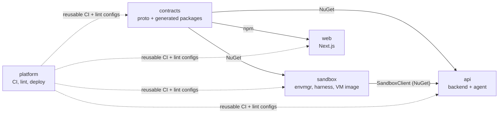
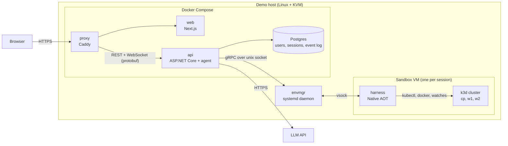

# kubernetes-learning-platform

> **An AI tutor combined with a live Kubernetes lab**, where every explanation is backed by real infrastructure you can see, poke and break.

You ask the agent to explain or demonstrate a Kubernetes concept: rolling updates, scheduling, service discovery, a `CrashLoopBackOff`. The agent then builds and operates a **real, disposable 3-node cluster** in an isolated VM. It deploys apps, breaks things on purpose and troubleshoots them, while a **live visual interface** shows every change as it happens. You can take control at any point and fix things yourself.

University team project · demo-only, single host · *"kubernetes-learning" is a placeholder name*

---

## 📚 Documentation

| Document | What's in it |
|---|---|
| [ARCHITECTURE.md](ARCHITECTURE.md) | **Start here.** Repos, services, controllers, contracts, key flows, per-repo folder trees, CI/CD, milestones, risks |
| [FEATURES.md](FEATURES.md) | Every feature, explained twice: what the user sees and how it works technically |
| [PROJECT-BRIEF.md](PROJECT-BRIEF.md) | The original brief: product intent, sandbox design, agent tools, rejected alternatives |

Decision labels used throughout: **DECIDED** (agreed) · **DEFAULT** (proposed, not objected to) · **OPEN** (not decided) · **CALL** (chosen during planning, change freely).

---

## 🗂️ Repositories

GitHub has no nested repos, so the organization is the container and **this repo is the parent** that links everything.

| Repo | Purpose | Owner | Status |
|---|---|---|---|
| **[docs](https://github.com/kubernetes-learning-platform/docs)** | This documentation hub | Filip (everyone contributes) | ✅ |
| **[contracts](https://github.com/kubernetes-learning-platform/contracts)** | Protobuf schema for the whole system → NuGet + npm packages | Filip | README only |
| **[sandbox](https://github.com/kubernetes-learning-platform/sandbox)** | `envmgr` (host daemon), `harness` (in-VM agent), SandboxClient library, VM base image, lesson images | Filip | README only |
| **[api](https://github.com/kubernetes-learning-platform/api)** | ASP.NET Core backend + the Agent library + curated lessons | Person 2 (Agent + lessons: Filip) | README only |
| **[web](https://github.com/kubernetes-learning-platform/web)** | Next.js frontend: canvas, chat, terminal, inspector, replay | Person 3 | README only |
| **[platform](https://github.com/kubernetes-learning-platform/platform)** | Shared CI workflows, lint configs, deploy + dev Compose files | Filip | README only |



---

## 🏗️ Architecture at a glance



**Three ideas shape everything:**

1. **The agent's brain lives in the backend; the VM gets a thin executor.** The LLM loop runs in `api`. The `harness` only executes commands and observes, so API keys never enter the VM, and a VM can die without losing the conversation.
2. **The view never trusts the narrator.** The canvas is drawn *only* from real cluster state (the harness watches Kubernetes). The agent can only move the camera (`focus`, `highlight`, `annotate`). If the agent says "done" while a pod is crashing, you see the crash.
3. **Faults are typed tools, not ad-hoc shell commands.** `kill_node`, `partition`, `bad_image` are recorded and reversible, so the UI knows exactly what was broken.

### Services

| Service | Tech | Runs | Entry points |
|---|---|---|---|
| **web** | Next.js (React Flow, xterm.js, Monaco) | Docker Compose | Routes: `/`, `/login`, `/session/[id]`, `/session/[id]/replay` |
| **api** | ASP.NET Core, .NET 10 | Docker Compose | **4 controllers**: `Auth`, `Sessions`, `Lessons`, `Events` · WebSocket `/ws/sessions/{id}` |
| **envmgr** | .NET 10 daemon | systemd on the host | **1 gRPC service**: `Create` / `Destroy` / `Get` / `List` / `Watch` sandbox + `Connect` relay |
| **harness** | .NET 10 Native AOT | inside every sandbox VM | Frame router → `Exec`, `Pty`, `File`, `Fault` handlers + Kubernetes/Docker watchers |
| Postgres | off the shelf | Docker Compose | Users, sessions, append-only event log |
| Caddy | off the shelf | Docker Compose | `/` → web, `/api` + `/ws` → api |

---

## 📁 Workspace folder structure

Clone every repo side by side into one local folder. Full per-repo trees are in [ARCHITECTURE.md §7](ARCHITECTURE.md#7-folder-structure).

```
kubernetes-learning/                          # local workspace
├── docs/                                     # ← this repo
├── contracts/
│   ├── proto/kubernetes_learning/v1/         # common, envmgr, harness, topology, view, session, rest
│   ├── dotnet/KubernetesLearning.Contracts/  # → NuGet
│   └── ts/                                   # → @kubernetes-learning-platform/contracts (npm)
├── sandbox/
│   ├── src/
│   │   ├── KubernetesLearning.EnvManager/    # VM lifecycle, warm pool, gRPC service, harness relay
│   │   ├── KubernetesLearning.Harness/       # exec, PTY, files, faults, watchers, topology, traffic probe
│   │   ├── KubernetesLearning.SandboxClient/ # → NuGet, used by api (+ a fake sandbox for dev)
│   │   └── KubernetesLearning.Sbx/           # dev CLI: create | exec | watch | destroy
│   ├── tests/
│   └── images/
│       ├── base/                             # VM base image (Linux + Docker + k3d + harness)
│       └── lessons/                          # demo-web v1/v2, traffic-probe
├── api/
│   ├── src/
│   │   ├── KubernetesLearning.Api/           # Controllers/, Realtime/, Sessions/, Auth/, Persistence/
│   │   └── KubernetesLearning.Agent/         # AgentRunner, tools, LLM client, lesson checkpoints
│   ├── lessons/                              # curated lesson YAML
│   └── tests/
├── web/
│   └── src/
│       ├── app/                              # routes
│       ├── components/                       # topology, chat, terminal, inspector, timeline, session
│       ├── lib/                              # REST + WebSocket (protobuf) clients
│       └── state/                            # topology / view / session reducers
└── platform/
    ├── .github/workflows/                    # reusable: dotnet-ci, node-ci, proto-ci, publish, release, vm-image
    ├── lint/                                 # canonical .editorconfig, analyzers, eslint, prettier
    ├── deploy/                               # docker-compose.yml, Caddyfile, envmgr.service, install.sh
    └── dev/                                  # local dev compose (Postgres + api with a fake sandbox)
```

---

## 🚀 Getting started

> Every repo exists, but the code repos only hold a README so far. Code lands in M1.

```bash
mkdir kubernetes-learning && cd kubernetes-learning
for repo in docs contracts sandbox api web platform; do
  git clone https://github.com/kubernetes-learning-platform/$repo.git
done
```

You'll need:
- .NET 10 SDK
- Node.js LTS
- Docker Desktop (give it ≥ 6 GB of memory for one local sandbox)
- A GitHub personal access token with `read:packages`, to install the `contracts` packages from GitHub Packages

Nobody needs KVM for day-to-day work. `envmgr` has a **Docker provider** for macOS/Windows, and `api` can run against a **fake sandbox** that plays a scripted cluster.

---

## 👥 Team

| | Owns |
|---|---|
| **Filip** | Infra for every repo (CI, lint, releases, deploy), `contracts`, `sandbox`, the Agent, curated lessons |
| **Person 2** | `api`: auth, sessions, WebSocket gateway, persistence, event log, control lock |
| **Person 3** | `web`: topology canvas, chat, terminal, config inspector, timeline/replay |

## 🛣️ Roadmap

| Milestone | Demoable result |
|---|---|
| **M1 Sandbox** | A 3-node cluster comes up in an isolated sandbox; commands run over vsock; the UI renders a (fake) topology |
| **M2 Agent** | Chat with the agent; it runs typed tools; streamed answers; live terminal |
| **M3 Live view** | Real topology from the cluster's watch streams, agent-driven camera, YAML inspector |
| **M4 Lessons** | Fault injection, lessons with checkpoints, traffic animation, take control / hand back, replay |

**Stretch:** bring-your-own repo, add/remove nodes, spectator mode, real VMs as nodes.

## 📄 License

[MIT](LICENSE)
