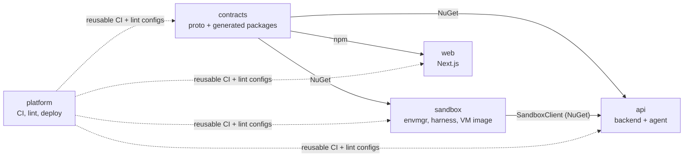
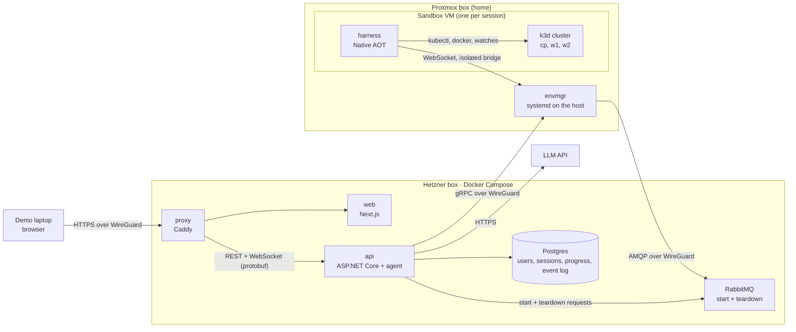

# kubernetes-learning-platform

> **A live Kubernetes lab with an optional AI helper**, where you learn by doing on real infrastructure you can see, poke and break.

One click gives you a **real, disposable 3-node cluster** in an isolated VM and a real terminal, with full `kubectl` freedom. You work on your own or through a **scenario** with automatic checks, such as fixing a broken ingress, while a **live visual interface** shows every change as it happens. If you want, an **AI helper** can explain what's going on and demonstrate a step, showing every command and asking you how to continue.

University team project · demo-only · a Hetzner box + a Proxmox box at home on a WireGuard mesh · *"kubernetes-learning" is a placeholder name*

---

## 📚 Documentation

| Document | What's in it |
|---|---|
| [ARCHITECTURE.md](ARCHITECTURE.md) | **Start here.** Repos, services, controllers, contracts, key flows, per-repo folder trees, CI/CD, milestones, risks |
| [FEATURES.md](FEATURES.md) | Every feature, explained twice: what the user sees and how it works technically |
| [PROJECT-BRIEF.md](PROJECT-BRIEF.md) | The original brief: product intent, sandbox design, agent tools, rejected alternatives |
| [adr/](adr/) | Architecture decision records, one per decision. [0001](adr/0001-hosting-and-harness-transport.md): hosting over a WireGuard mesh, Proxmox sandboxes, WebSocket-only harness. [0002](adr/0002-learner-driven-scenarios-and-scale-target.md): learner-driven scenarios, the optional helper, RabbitMQ, the 30-sandbox design target |

Decision labels used throughout: **DECIDED** (agreed) · **DEFAULT** (proposed, not objected to) · **OPEN** (not decided) · **CALL** (chosen during planning, change freely).

---

## 🗂️ Repositories

GitHub has no nested repos, so the organization is the container and **this repo is the parent** that links everything.

| Repo | Purpose | Owner | Status |
|---|---|---|---|
| **[docs](https://github.com/kubernetes-learning-platform/docs)** | This documentation hub | Filip (everyone contributes) | ✅ |
| **[contracts](https://github.com/kubernetes-learning-platform/contracts)** | Protobuf schema for the whole system → NuGet + npm packages | Filip | README only |
| **[sandbox](https://github.com/kubernetes-learning-platform/sandbox)** | `envmgr` (daemon on the Proxmox box), `harness` (in-VM agent), SandboxClient library, Proxmox VM template, scenario images | Filip | README only |
| **[api](https://github.com/kubernetes-learning-platform/api)** | ASP.NET Core backend + the Scenarios and Agent libraries | Person 2 (Scenarios + Agent: Filip) | README only |
| **[web](https://github.com/kubernetes-learning-platform/web)** | Next.js frontend: canvas, scenarios, terminal, helper chat, inspector, replay | Person 3 | README only |
| **[platform](https://github.com/kubernetes-learning-platform/platform)** | Shared CI workflows, lint configs, infrastructure code, deploy files per machine (including RabbitMQ), dev Compose | Filip | README only |

A seventh repo, `scenarios`, gets created once the flow is up and working. Until then, the first scenario lives in `api`.



---

## 🏗️ Architecture at a glance



**Four ideas shape everything:**

1. **The learner drives.** The terminal is yours by default, and scenarios and their checks work with no LLM. The helper only acts when you ask, shows every command, and then asks you how to continue.
2. **The helper's brain lives in the backend; the VM gets a thin executor.** The LLM loop runs in `api`. The `harness` only executes commands and observes, so API keys never enter the VM, and a VM can die without losing the conversation.
3. **The view never trusts the narrator.** The canvas is drawn *only* from real cluster state (the harness watches Kubernetes). The helper can only move the camera (`focus`, `highlight`, `annotate`). If it says "done" while a pod is crashing, you see the crash.
4. **Faults are typed tools, not ad-hoc shell commands.** `kill_node`, `partition`, `bad_image` are recorded and reversible, so the UI knows exactly what was broken.

### Machines

All three are on one **WireGuard mesh**. Nothing is public: the app is only reachable over the mesh. Details in [ARCHITECTURE §3.1](ARCHITECTURE.md#31-machines-and-the-mesh) and [ADR 0001](adr/0001-hosting-and-harness-transport.md).

| Machine | Runs | Mesh address |
|---|---|---|
| **Hetzner box** | Docker Compose: Caddy, `web`, `api`, Postgres, RabbitMQ. The only peer with a public endpoint (WireGuard + SSH only). | `10.66.0.1` |
| **Proxmox box** (home) | Proxmox VE, `envmgr`, one sandbox VM per session on an isolated bridge | `10.66.0.2` |
| **Demo laptop** | The browser on the projector | `10.66.0.3` |

### Services

| Service | Tech | Runs | Entry points |
|---|---|---|---|
| **web** | Next.js (React Flow, xterm.js, Monaco) | Docker Compose on the Hetzner box | Routes: `/`, `/login`, `/session/[id]`, `/session/[id]/replay` |
| **api** | ASP.NET Core, .NET 10 | Docker Compose on the Hetzner box | **4 controllers**: `Auth`, `Sessions`, `Scenarios`, `Events` · WebSocket `/ws/sessions/{id}` |
| **envmgr** | .NET 10 daemon | systemd on the Proxmox host | **1 gRPC service** on the mesh: `Create` / `Destroy` / `Get` / `List` / `Watch` sandbox + `Connect` relay · harness WebSocket on the sandbox bridge · consumes start and teardown requests from RabbitMQ |
| **harness** | .NET 10 Native AOT | inside every sandbox VM | Frame router → `Exec`, `Pty`, `File`, `Fault`, `Check` handlers + Kubernetes/Docker watchers |
| Postgres | off the shelf | Docker Compose on the Hetzner box | Users, sessions, progress, append-only event log |
| RabbitMQ | off the shelf | Docker Compose on the Hetzner box | Sandbox start and teardown requests only; live streams stay direct |
| Caddy | off the shelf | Docker Compose on the Hetzner box | `/` → web, `/api` + `/ws` → api, HTTPS on the mesh address only |

---

## 📁 Workspace folder structure

Clone every repo side by side into one local folder. Full per-repo trees are in [ARCHITECTURE.md §7](ARCHITECTURE.md#7-folder-structure).

```
kubernetes-learning/                          # local workspace
├── docs/                                     # ← this repo
├── contracts/
│   ├── proto/kubernetes_learning/v1/         # common, envmgr, harness, topology, view, session, rest, jobs
│   ├── dotnet/KubernetesLearning.Contracts/  # → NuGet
│   └── ts/                                   # → @kubernetes-learning-platform/contracts (npm)
├── sandbox/
│   ├── src/
│   │   ├── KubernetesLearning.EnvManager/    # VM lifecycle, warm pool, gRPC service, harness relay
│   │   ├── KubernetesLearning.Harness/       # exec, PTY, files, faults, watchers, topology, traffic probe
│   │   ├── KubernetesLearning.SandboxClient/ # → NuGet, used by api (+ a fake sandbox for dev)
│   │   └── KubernetesLearning.Sbx/           # dev CLI: create | exec | watch | destroy
│   ├── tests/
│   └── images/
│       ├── base/                             # Packer: Proxmox VM template (Linux + Docker + k3d + harness)
│       └── scenarios/                        # demo-web v1/v2, traffic-probe
├── api/
│   ├── src/
│   │   ├── KubernetesLearning.Api/           # Controllers/, Realtime/, Sessions/, Provisioning/, Auth/, Persistence/
│   │   ├── KubernetesLearning.Scenarios/     # scenario catalog, runner and checks; no LLM dependency
│   │   └── KubernetesLearning.Agent/         # the optional helper: AgentRunner, tools, LLM client
│   ├── scenarios/                            # the first scenario, until the `scenarios` repo exists
│   └── tests/
├── web/
│   └── src/
│       ├── app/                              # routes
│       ├── components/                       # topology, scenario panel, chat, terminal, inspector, timeline
│       ├── lib/                              # REST + WebSocket (protobuf) clients
│       └── state/                            # topology / view / scenario / session state
└── platform/
    ├── .github/workflows/                    # reusable: dotnet-ci, node-ci, proto-ci, publish, release, vm-image
    ├── lint/                                 # canonical .editorconfig, analyzers, eslint, prettier
    ├── infra/                                # OpenTofu: hetzner/ (server, firewall), proxmox/ (bridge, pool, token)
    ├── deploy/                               # hetzner/ (compose with RabbitMQ, Caddyfile), proxmox/ (envmgr unit, nftables), wireguard/
    └── dev/                                  # local dev compose (Postgres + api with a fake sandbox)
```

---

## 🚀 Getting started

> Every repo exists, but the code repos only hold a README so far. Code lands in M1.

```bash
mkdir kubernetes-learning && cd kubernetes-learning
for repo in docs contracts sandbox api web platform; do
  git clone https://github.com/kubernetes-learning-platform/$repo.git
done
```

You'll need:
- .NET 10 SDK
- Node.js LTS
- Docker Desktop (give it ≥ 6 GB of memory for one local sandbox)
- A GitHub personal access token with `read:packages`, to install the `contracts` packages from GitHub Packages

Nobody needs KVM or Proxmox for day-to-day work. `envmgr` has a **Docker provider** for macOS/Windows, and `api` can run against a **fake sandbox** that plays a scripted cluster. To open the deployed app, ask Filip for a WireGuard peer config.

---

## 📏 Conventions

- **Commits:** strict [Conventional Commits](https://www.conventionalcommits.org/), one line, e.g. `feat: add warm pool`. No body, no co-author trailers.
- **PRs:** the title uses the same format. Every repo only allows squash merges, and the squash commit is the PR title, so `main` gets one clean line per change. A check fails any PR whose title doesn't follow the format.
- **Copilot:** every PR gets one Copilot review when it opens, except Markdown-only PRs and PRs labelled `skip-copilot`. It needs Copilot on your account, which is free through GitHub Student.
- **Branches:** `type/anything`, e.g. `feat/warm-pool` or `fix/harness-reconnect`, deleted after merging. For an issue, use its **Create a branch** button and rename the suggested branch to match.

More in [platform → Conventions](https://github.com/kubernetes-learning-platform/platform#-conventions).

---

## 👥 Team

| | Owns |
|---|---|
| **Filip** | Infra for every repo (CI, lint, releases, deploy), the machines and the mesh, `contracts`, `sandbox`, the Scenarios and Agent libraries, curated scenarios |
| **Person 2** | `api`: auth, sessions, WebSocket gateway, persistence, event log, queue integration, progress |
| **Person 3** | `web`: topology canvas, scenario panel, chat and question card, terminal, config inspector, timeline/replay |

## 🛣️ Roadmap

| Milestone | Demoable result |
|---|---|
| **M1 Sandbox** | A 3-node cluster comes up in a Proxmox sandbox; commands run over the harness WebSocket; the UI renders a (fake) topology |
| **M2 Scenarios** | One click starts a queued sandbox; a real terminal; the first scenario with checks and reset, no LLM needed; the stack is deployed on the Hetzner box over the mesh |
| **M3 Live view** | Real topology from the cluster's watch streams, including Ingress; YAML inspector |
| **M4 Helper** | The optional helper: typed tools, streamed answers, demonstrations with feedback questions, an agent-driven camera |
| **M5 Scenarios + scale** | The full 3–5 scenarios, the `scenarios` repo, a load test, timeline + replay, traffic animation |

The final demo is **by June 2027**. The design target is 30 concurrent sandboxes, and only what the demo needs gets provisioned.

**Stretch:** bring-your-own repo, add/remove nodes, spectator mode, real VMs as nodes.

## 📄 License

[MIT](LICENSE)
