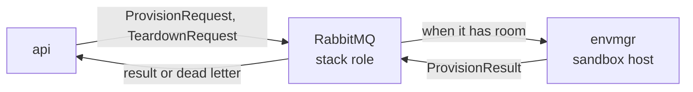

# ADR 0002: Learner-driven scenarios, an optional helper, and a 30-sandbox design target

- **Status:** Accepted · 2026-11-04 · **DECIDED** by Filip
- **Changes:** the agent-driven product shape, the control model and the lesson design in [ARCHITECTURE](../ARCHITECTURE.md) and [FEATURES](../FEATURES.md). It also overrides [PROJECT-BRIEF](../PROJECT-BRIEF.md) §11's rejection of a job queue, **for sandbox provisioning only**.
- **Builds on:** [ADR 0001](0001-hosting-and-harness-transport.md). The isolated sandbox bridge doesn't change.
- **Changed by:** [ADR 0003](0003-course-vm-hosting.md), 2026-11-14. The machine details below (the Hetzner box, the home PC, the mesh, RabbitMQ on `10.66.0.1`) are replaced by one course-provided VM reached over Tailscale. The demo runs on the VM, shown from Filip's laptop. Everything else here holds.

Labels: **DECIDED** by Filip · **CALL** chosen while writing this, change freely · **OPEN** not decided.

---

## Context

The plan so far is built around the agent. It drives by default, runs a lesson, and the user can take control. Filip's vision reverses that: the learner is at the keyboard with a real cluster, and the agent is a helper they can choose to use.

## Decision

### 1. The product (DECIDED)

One click gives you a ready 3-node cluster and a real terminal, with full `kubectl` freedom. You start with a **scenario**, or with a blank cluster (CALL). Scenarios cover the Kubernetes basics and some more advanced topics: services, ingress, how YAML works, `kubectl` commands, and fixing things like an ingress with no service behind it.

- **Goals:** learn by doing on real infrastructure · see every change live · 3–5 ready-made scenarios from simple to complex · adding a scenario is easy · everything except the helper works with no LLM.
- **Non-goals:** public internet access (mesh only, per ADR 0001) · admin tools · multiple `api` instances, high availability or autoscaling.
- **Anti-goals:** a helper that acts without being asked · a canvas drawn from what the helper says · scenarios that need an LLM to run or to pass · a broker in any live path.

The final demo is **by June 2027**, on Filip's laptop with sandboxes on his home PC (DECIDED). The exact scenario list and Helm are decided later (OPEN).

### 2. The learner drives (DECIDED)

The terminal and the editable config inspector belong to the learner by default. A helper turn only ever starts from a learner's message or answer, so the helper can't act on its own (CALL: this is enforced in code, by having no other way to start a turn).

| Helper is | Learner's terminal + inspector | Helper can use |
|---|---|---|
| **Idle** | Writable | Nothing, because no turn is running |
| **Acting** on a request | Read-only, with a **Stop** button (CALL) | Observe, view, execute and fault tools |
| **Waiting** on its question | Writable | Nothing until the answer arrives |

- This replaces `ControlTake` / `ControlRelease`, `AgentPause` / `AgentResume`, `ControlState`, the `ControlLock` and the agent checkpoint nudges. **Stop** ends the turn at the next tool boundary. A chat message sent while the helper is acting waits until the turn ends (CALL).
- A shorter version of the takeover summary stays (CALL): every helper turn starts with what the learner typed and what changed in the cluster since the last turn.
- **Unchanged:** the canvas draws only real cluster state, with the helper on or off. The helper only adds `ViewIntent`s: focus, highlight, annotate, show config.

### 3. The helper is feedback-driven (DECIDED)

1. The learner asks, for example: "Can you demonstrate the first part of this scenario and explain it?"
2. The helper does it. Every command is visible in the terminal as `agent$ …`, with highlights and notes on the canvas.
3. When it judges that it should, it stops and asks a question it **writes itself**, with its own options. For example: "Should I continue?" → *Yes* · *Wait, I have a question* · *No, do it again* · *No, I want to continue myself* · *No, reset it so I can try this part myself*.
4. Nothing happens until the learner answers.

To build this:
- New agent tool: `ask_user(question, options[])`. The turn suspends until the answer becomes the tool's result.
- New agent tool: `reset_step()`, so the helper can act on a "reset it" answer.
- New messages: `AgentQuestion{questionId, text, options[]}`, `AgentAnswer{questionId, optionId | text}`, `HelperStop`, `HelperState{idle | acting | waiting}`.
- The question card always offers free text as well (CALL). A normal chat message sent while a question is open counts as its answer (CALL).
- When the token budget runs out, the helper turns off and says so. The scenario carries on (CALL).

### 4. Scenarios (DECIDED: a folder per scenario, automatic checks, reset to the step's start)

A scenario is a folder, not a VM image. **One shared VM template** holds the tools and all container images (DECIDED), and `api` sends the scenario's files to the sandbox through the harness when it starts. Only a scenario that needs a brand-new container image requires rebuilding the template.

```yaml
# broken-ingress/scenario.yaml (format is a CALL)
id: broken-ingress
title: Fix a broken ingress
level: beginner
namespaces: [shop]            # everything the scenario owns; reset wipes these
images: [demo-web:v1]         # must be baked into the VM template
steps:
  - id: restore-the-site
    goal: The site returns 503. Find out why and fix it.
    start: manifests/step-1/  # full state at this step's start, used by start and reset
    enter: null               # optional: applied when arriving from the previous step
    faults: []                # optional: typed faults to inject, recorded in the ledger
    checks:
      - resource: { kind: Service, namespace: shop, name: web }
      - http: { url: "http://localhost/", host: shop.localhost, status: 200 }
    hints:                    # shown on request, no LLM needed
      - Which Service does the Ingress point at? Does it exist?
    helper: |                 # optional notes for demonstrating this step
      Start from `kubectl describe ingress`, then compare it with `kubectl get svc`.
    solution: manifests/step-1-solved/  # optional: lets CI prove the step can be passed
```

- **Checks** run inside the VM through the harness, so they test real behaviour without an LLM. There are three types: `resource` (exists, or a field has a value), `http` (status code, requested from inside the VM) and `command` (exit code). `api` runs them about every 3 seconds and on topology changes while a step is active. A step passes when all its checks pass.
- **Moving on** is the learner's choice: a passed step shows a **Next** button, and nothing changes in the cluster until they click it (CALL).
- **Reset** (DECIDED: back to this step's start): revert the step's faults through the `FaultLedger`, delete the scenario's namespaces, apply `start`. A separate **Start over** button replaces the sandbox with a fresh VM (CALL). Scenarios keep their resources inside their own namespaces, so anything cluster-wide or changed outside them needs **Start over**. It's also the only reset for a blank cluster (CALL).
- **One scenario per session** (CALL): picking a different scenario starts a new sandbox, so scenarios never have to clean up after each other.
- **Where they live** (DECIDED): a `scenarios` repo, created only **once the flow is up and working**. Until then, the first scenario lives in `api/scenarios/<id>/` and its custom images in `sandbox/images/`.
- **Testing a scenario** (CALL): apply `start`, apply `solution`, and confirm the checks pass. CI runs this, so a new scenario can't ship unsolvable.
- **Code:** a new `KubernetesLearning.Scenarios` project in `api` (CODEOWNERS: Filip) holds `ScenarioCatalog`, `ScenarioDefinition` and `ScenarioRunner`. They move out of the Agent library because they must work with the helper off (CALL).
- **Harness:** a new `CheckHandler`, and the watchers and topology grow to cover Ingress, StatefulSets and the other kinds the scenarios need (the first being Ingress).
- **Naming** (CALL): "lesson" becomes "scenario" everywhere (`ScenariosController`, `ScenarioProgress`, `scenarioId`). `contracts` hasn't shipped, so this costs nothing.

The stuck-rollout lesson, the traffic probe and the recorded fallback sessions stay, as things a scenario can use.

### 5. Design target: 30 concurrent sandboxes (DECIDED)

Planning for more usage than the demo needs leads to better decisions. **Nothing beyond what the demo needs gets provisioned.** All of this is CALL except the target itself:

| Area | Decision |
|---|---|
| **Machines** | Two roles, the **stack** and the **sandbox host**, connected by configured addresses. Today they're the Hetzner box and the home PC. Nothing may assume they're separate machines, or that there's only one sandbox host. |
| **Capacity** | A hard cap per host, `Sandbox__MaxConcurrent`, set from that host's RAM. It counts every running VM, warm ones included. Over the cap, a session waits: `SessionStatus{queued, position}`. `WarmPool__Size` stays a setting and can be raised ahead of busy periods. |
| **RAM** | The real limit. 4 GB per sandbox is an estimate: 30 would need about 120 GB before any sharing between identical clones. Measure real usage in M1, including Proxmox's KSM memory sharing. |
| **`api`** | One instance. 30 sessions should fit, and the load test confirms it. |
| **Event log** | Persist-then-broadcast stays. Terminal output is batched (about 50 ms) before it's written, so typing doesn't mean one database row per chunk. |
| **LLM** | A global limit on concurrent helper turns (`Agent__MaxConcurrentTurns`) on top of the per-session token budget. |
| **Link drops** | Every session reconnects at the same moment, so redials use backoff **with jitter**. |
| **Load test** | 30 scripted sessions against `FakeSandboxSession`, plus as many real sandboxes as the home PC holds. |

### 6. RabbitMQ for sandbox start and teardown only (DECIDED)

Starts arrive in bursts and capacity is limited, so requests wait in a work queue. `envmgr` takes one only when it has room. A second sandbox host later is just a second consumer, with no scheduler to write. Kafka is out: this is a work queue, not an event stream.



1. `POST /api/sessions` creates a `queued` session and publishes `ProvisionRequest{requestId, scenarioId?}` with a publisher confirm. If the broker can't be reached, it returns "try again" (a message published while disconnected is otherwise lost).
2. `envmgr` consumes with manual acks. It takes a warm sandbox or clones one, and pauses its consumer when no warm sandbox is free and it's at `Sandbox__MaxConcurrent`. Redeliveries happen, so it records `requestId` with the sandbox and handles repeats idempotently.
3. It publishes `ProvisionResult{requestId, sandboxId, host}`, then acks. `host` is that `envmgr`'s gRPC address. `api` stores it per session and opens `Connect` to it, which replaces the single `EnvManager__Address`. If the session was cancelled meanwhile, `api` publishes a teardown instead.
4. After repeated failures (the queue's delivery limit), the request dead-letters, and `api` marks the session failed and tells the browser.
5. `TeardownRequest` works the same way, so a teardown survives a link drop. `Sandbox__MaxLifetime` stays as the backstop.

Details (all CALL):
- **Placement:** one RabbitMQ node in Compose on the stack box, so requests still queue while the home link is down. It listens on the Docker network and `10.66.0.1:5672`, firewalled to sandbox hosts, with its own credentials (`RabbitMq__Url`). Sandboxes can't reach it: the bridge rules from ADR 0001 stay exactly as they are.
- **Queues:** quorum queues with one member, for the delivery limit and dead-lettering. One node gives no fault tolerance, which is accepted.
- **Client:** the official `RabbitMQ.Client` with automatic recovery, in `api` and `envmgr`. The harness never touches the broker, so Native AOT isn't affected.
- **Messages:** Protobuf in a new `jobs.proto`, covered by `buf lint` and `buf breaking`.
- **Queue position:** `api` computes it from its own `queued` sessions in Postgres. RabbitMQ doesn't report it.
- **Local development:** `Sandbox__Mode=Fake` needs no broker, behind an `ISandboxProvisioner` seam. `CreateSandbox` over gRPC stays for the `sbx` dev CLI.

**Not on the broker:** chat, tool calls, terminal, topology, checks and the event log. PROJECT-BRIEF §11's reasoning still holds for those: they're per-session, ordered and latency-sensitive, so they stream directly.

### 7. Progress per account (DECIDED)

`scenario_progress (user_id, scenario_id, step_id, status, helper_demonstrated, updated_at)`. The home screen shows what you've finished and what's next. A step the helper demonstrated still counts, and the flag records that it did (CALL).

### 8. Milestones (CALL)

The helper moves later, because the product must work without it.

| | Filip | Person 2 | Person 3 |
|---|---|---|---|
| **M1 Sandbox** | As planned, plus measuring real sandbox RAM | As planned | As planned |
| **M2 Scenarios** | Harness PTY, checks and reset, `ScenarioRunner`, first scenario, RabbitMQ + `jobs.proto`, `envmgr` consumer, first deploy | Scenario and progress endpoints, queue integration, `queued` state, PTY plumbing, batched terminal writes, idle reaper | Home screen, scenario panel (goal, checks, hints, reset), terminal, queued state |
| **M3 Live view** | Watchers → topology, including Ingress | `TopologyCache`, persist-then-broadcast, `Resync` | Real canvas, inspector + Apply |
| **M4 Helper** | Agent loop, tools, `ask_user`, `reset_step`, view tools, fault tools + ledger | `AgentRunner` in `LiveSession`, `HelperState`, Stop, LLM limits | Chat, question card, camera and notes on the canvas |
| **M5 Scenarios + scale** | `scenarios` repo, the full 3–5 scenarios, CI scenario tests, traffic probe, recorded fallback sessions | Load test, `EventsController` | Timeline + replay, traffic animation, polish |

## Consequences

**Better:**
- The core works and can be demonstrated before any LLM work, and it can't be taken down by an LLM outage.
- The control model gets much simpler.
- A new scenario is a folder and a PR, usually with no template rebuild.
- Reset and checks make the helper's "try it yourself" flow possible.

**Costs:**
- One more service to run on the small Hetzner box, whose size is still OPEN.
- Start requests gain moving parts: redeliveries, dead letters and a broker that can be down.
- The `api` ↔ `envmgr` link now has two channels, gRPC and AMQP, and both must recover from drops.
- `envmgr` gains a queue consumer and a capacity check on top of its reconcile loop.
- Checks run real commands every few seconds in each sandbox, so they must stay cheap.
- More of the build lands on Filip in M2.

## Labels changed

| Item | Was | Now |
|---|---|---|
| Who drives | Agent by default, user takes control | Learner by default, helper only on request (DECIDED) |
| Lessons | Checkpoints over the topology, evaluated in the Agent library | Scenarios with behaviour checks, no LLM needed (DECIDED) |
| Job queue | Rejected (brief §11) | RabbitMQ for sandbox start and teardown only (DECIDED) |
| Scale | Warm pool of 1–2 | Design target of 30 concurrent sandboxes; provision only what the demo needs (DECIDED) |
| Repos | 6 | 7 once the flow works, adding `scenarios` (DECIDED) |
| User data | Users, sessions, events | Also progress per scenario step (DECIDED) |
| Final demo | Unknown | By June 2027 (DECIDED) |

## Alternatives considered

- **One VM image per scenario.** Slow builds, more storage, and a warm pool can't keep every scenario ready. Rejected.
- **The LLM judges completion.** Costs credits, can be wrong, and fails with the helper off. Rejected.
- **A fresh VM for every reset.** The cleanest state, but slow and hard on the warm pool. Kept only as **Start over**.
- **A Postgres table as the queue.** No new service and positions are easy, but `api` would have to schedule across hosts, and `envmgr` has no database access. Rejected.
- **Kafka.** Built for event streams rather than work queues, and heavier to run. Its JVM wasn't the reason: `api` would only need a .NET client. Rejected.
- **Failing with "no capacity" and no queue.** The simplest option, but it gives up the design target. Rejected.

## Still OPEN

- The scenario list, and whether Helm is included.
- LLM provider and token budget, and the auth mechanism (carried over from ARCHITECTURE §11).
- The Hetzner box's size, now that it also runs RabbitMQ.
- The home PC's RAM, which sets `Sandbox__MaxConcurrent` for the demo.
- How long to keep `session_events` for finished sessions.
- Anything the course itself requires.
